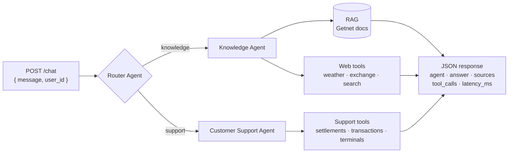

# SPEC — Getnet Multi-Agent Support System

> This project follows **Spec-Driven Development (SDD)**: this document defines what the system must do,
> the contracts between components and the acceptance criteria used to validate it.

## 1. Overview

Develop an AI support system that classifies merchant requests and routes them to specialized agents.

Getnet merchants ask different kinds of questions through a single channel:

| Request type | Example | What it needs |
|---|---|---|
| Getnet products and services | "What's the difference between the Get Clássica and the Get Smart?" | Getnet documentation (RAG) |
| General questions | "What's the weather forecast in Porto Alegre tomorrow?" | External tools (web) |
| Customer-specific inquiries | "When will the money from yesterday's sales be deposited?" | The merchant's own data (support tools) |

**Goal:** one HTTP endpoint that receives `{message, user_id}`, decides which agent should handle it,
and returns a grounded, structured JSON answer.

## 2. Technology Stack

| Component | Technology |
|---|---|
| Language | Python 3.15.2 |
| API | FastAPI + Uvicorn |
| LLM | OpenAI (`gpt-4o-mini`), configurable via environment variables |
| Embeddings | OpenAI Embeddings (`text-embedding-3-small`) |
| Vector Search | NumPy (cosine similarity, index persisted on disk) |
| Document ingestion | Requests, BeautifulSoup, pypdf |
| Customer Data | JSON (mock of Getnet merchant APIs) |
| Web tools | Open-Meteo (weather), Frankfurter (exchange rates), DuckDuckGo (web search) |
| Testing | Pytest |
| Containerization | Docker (`python:3.15.2-slim`) + Docker Compose |

## 3. System Architecture



Agents communicate through **direct function calls** coordinated by the API layer (orchestrator).
Every agent returns the same output contract (see § 6).

### Router Agent
- Single entry point for every message.
- Identifies user intent and selects `knowledge` or `support`.
- Uses the LLM in JSON mode with a few-shot prompt and temperature 0.
- Handles invalid classifications: if the LLM fails or returns an unknown agent, it falls back to `knowledge`.

### Knowledge Agent
- Uses RAG to retrieve Getnet documentation (getnet.net/en, site.getnet.com.br, official PDF manuals and curated notes).
- Uses web tools for general questions (weather, exchange rates, web search).
- Generates answers **only** from retrieved information, citing sources; says it doesn't know otherwise.

### Customer Support Agent
- Retrieves customer and transaction information through dedicated tools.
- Checks settlement dates, declined transactions and terminal status.
- The `user_id` is bound by the server; the LLM never receives or chooses it.

## 4. Tools

| Agent | Tool | Description |
|---|---|---|
| Knowledge | `get_weather` | Weather forecast for a city |
| Knowledge | `get_exchange_rate` | Reference exchange rate between two currencies |
| Knowledge | `web_search` | General web search |
| Customer Support | `get_settlement_schedule` | When the merchant's approved sales of a day will be deposited (business days) |
| Customer Support | `get_recent_transactions` | Recent and declined transactions, with the meaning of the decline code |
| Customer Support | `get_terminal_status` | Connectivity status of the merchant's card machines |

Tools never raise exceptions: on failure they return `{"error": "..."}` (e.g. `account_not_found`).

## 5. Functional Requirements

| ID | Requirement |
|---|---|
| FR-1 | Provide a `POST /chat` endpoint accepting `message` and `user_id`. |
| FR-2 | Return structured JSON responses (see § 6). |
| FR-3 | Route every message through the Router Agent. |
| FR-4 | Support RAG over Getnet documentation and web tools for general questions. |
| FR-5 | Implement at least two customer support tools (three are provided). |
| FR-6 | Keep customer data separate from public documentation. |
| FR-7 | Answer in the same language as the user (English, Portuguese, Spanish). |
| FR-8 | Provide a `GET /health` endpoint. |
| FR-9 | Run through Docker Compose with a single command. |

## 6. API and Agent Contracts

**Request — `POST /chat`**

```json
{
  "message": "string (1-2000 characters)",
  "user_id": "string (1-64 characters)"
}
```

**Router output**

```json
{ "agent": "knowledge | support", "reason": "string" }
```

**Agent output**

```json
{
  "agent": "knowledge | support",
  "answer": "string",
  "sources": ["url"],
  "tool_calls": [{ "tool": "string", "args": {} }]
}
```

**Response**

```json
{
  "user_id": "cliente1988",
  "route": { "agent": "support", "reason": "merchant's own settlement data" },
  "agent": "support",
  "answer": "Response text",
  "sources": [],
  "tool_calls": [{ "tool": "get_settlement_schedule", "args": { "sales_date": "yesterday" } }],
  "latency_ms": 0
}
```

**Health — `GET /health`**

```json
{ "status": "ok" }
```

## 7. Security and Reliability

| ID | Requirement |
|---|---|
| NFR-1 | Validate incoming requests (required fields, length limits); invalid input returns HTTP 422. |
| NFR-2 | Prevent unauthorized customer data access: support tools are bound to the request's `user_id` on the server side, and no tool schema exposes a `user_id` parameter to the LLM. |
| NFR-3 | Store API keys in environment variables (`.env`), never in the repository or the Docker image. |
| NFR-4 | Handle LLM and tool failures: the user never receives an HTTP 500; a friendly message is returned instead. |
| NFR-5 | Avoid unsupported answers: never invent fees, prices or deadlines; say "I don't know" and point to official channels. |
| NFR-6 | Log the route, the tools used and the execution time of every request. |

## 8. Acceptance Criteria

All scenarios use `user_id = "cliente1988"` unless stated otherwise.

| ID | Message | Expected agent | Must |
|---|---|---|---|
| AC-1 | What's the difference between the Get Clássica and the Get Smart? | knowledge | Compare both machines and return Getnet sources |
| AC-2 | What's the weather forecast in Porto Alegre tomorrow? | knowledge | Call `get_weather` |
| AC-3 | When will the money from yesterday's sales be deposited? | support | Call `get_settlement_schedule` and give deposit dates |
| AC-4 | Do I need a bank account to receive my sales via Pix? | knowledge | Mention the Santander bank domicile |
| AC-5 | My card machine won't connect to the internet, what should I do? | support | Call `get_terminal_status` and identify the offline machine |
| AC-6 | How does receivables advance (antecipação) work with Getnet? | knowledge | Explain the process with sources |
| AC-7 | What's the euro exchange rate today? | knowledge | Call `get_exchange_rate` |
| AC-8 | My card machine is showing a transaction decline error. | support | Call `get_recent_transactions` and explain the decline code |
| AC-9 | How many installments can I split a sale into with the crediário? | knowledge | Answer "up to 48" with sources |
| AC-10 | Can I sell through WhatsApp using the Payment Link? | knowledge | Explain the payment link with sources |
| AC-11 | Any message when the LLM returns invalid output | knowledge (fallback) | No error to the user |
| AC-12 | Deposit question with an unknown `user_id` | support | Graceful "account not found" answer |
| AC-13 | Deposit question with `user_id = "cliente2024"` | support | Only `cliente2024` data is returned (data isolation) |
| AC-14 | Empty `message` | — | HTTP 422 |
| AC-15 | `docker compose up --build` on a clean machine | — | API available at `http://localhost:8000` |

## 9. Out of Scope

- Merchant authentication (assumed to be handled by an API gateway).
- Real Getnet production APIs (mocked in `data/users.json` behind the same tool interface).
- Persistent conversation memory.
- Human escalation, guardrails and monitoring dashboards (considered as future improvements).

## 10. Traceability

| Requirement / Criterion | Validated by |
|---|---|
| Support tools logic, AC-3, AC-8, AC-12 | `tests/test_tools.py` |
| Router fallback (AC-11) and NFR-2 | `tests/test_router.py` |
| AC-1 … AC-10, AC-13 | Manual run of the scenarios against `/chat` |
| AC-14, NFR-1 | Pydantic validation (manual check in `/docs`) |
| AC-15, FR-9 | `docker compose up --build` |

## 11. Development Approach

Development follows Spec-Driven Development (SDD):

1. Write this specification and its acceptance criteria.
2. Implement each component in order (LLM client → RAG → tools → agents → API → Docker), one commit per step.
3. Validate each step against the acceptance criteria.

The priority is a functional core solution, clear component responsibilities and reproducible execution.
Additional features are added after the core requirements are completed, in separate commits.
